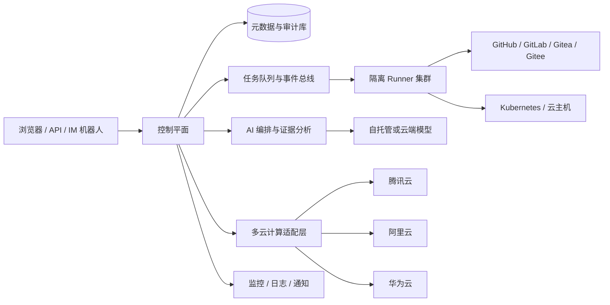

# AI DevOps 整体设计方案

## 1. 产品定位

AI DevOps 不是另一个云控制台，也不是让大模型直接获得云账号和服务器权限的聊天窗口。它的定位是：

> 面向研发团队的多云交付与运维控制面，用可审计的流水线承载变更，用 AI 降低理解、诊断和编排成本，用策略系统限制执行边界。

核心用户包括开发者、发布负责人、SRE、运维和研发管理者。平台在一个浏览器入口中贯通“需求/代码 -> 构建/测试 -> 发布 -> 观测 -> 故障处理 -> 复盘”的完整闭环。

## 2. 设计原则

1. **控制面与执行面分离**：Web、API、数据库不直接运行仓库脚本；构建、测试、部署由临时 Runner 执行。
2. **Git 与云是事实源**：代码版本以 Git commit 为准，云资源以云 API/CMDB 为准，平台只保存引用、缓存、流程状态和审计信息。
3. **默认只读，写操作分级**：AI 可以查询、分析和生成方案；生产修改必须经过策略、审批和回滚预案。
4. **Provider 可插拔**：仓库、云、模型、通知、密钥管理都通过统一适配接口接入，避免绑定单一厂商。
5. **一切可审计**：谁触发、基于哪个 commit、改了什么、证据是什么、谁批准、执行结果如何，都必须关联同一个变更单。
6. **先闭环，再扩展**：首版优先完成单团队可用流程，再扩展多租户、跨集群、复杂 DAG 和成本治理。

## 3. 总体架构

### 3.1 控制面

控制面由前端、API 服务、工作流引擎、身份与策略服务、事件总线组成。

- 项目、仓库、流水线、发布单、审批、环境和团队管理
- 流水线状态机与超时、重试、取消
- RBAC/ABAC 权限检查
- Webhook 接收与签名校验
- AI 会话、工具调用计划和证据链管理
- 审计日志与合规报表

### 3.2 执行面

Runner 是无状态、短生命的隔离 Pod 或容器，每次任务动态获得最小权限：

- 拉取指定 commit，不信任可变分支
- 运行构建、单元测试、安全扫描、镜像构建和签名
- 通过短期云凭证执行部署
- 上传日志、制品、SBOM 和签名证明
- 任务结束立即销毁，默认禁止特权容器和宿主机挂载

Runner 与控制面通过队列通信。控制面不保存 Runner 私钥，也不允许 Runner 任意回调管理 API。

### 3.3 多云适配层

统一接口包括身份验证、资源发现、指标查询、日志查询、变更执行和变更回滚。当前实现：

| 云 | 真实只读资源与指标 | 已实现的受控变更 |
| --- | --- | --- |
| 腾讯云 | CVM、Lighthouse、VPC、EIP、安全组、CLB、CBS、CDB、Redis、TKE、CFS、CynosDB、CDN、SSL、注册域名、DNSPod、COS；CVM 与 Lighthouse 读取 CPU/内存 | DNSPod 解析变更、Lighthouse 防火墙开放端口 |
| 阿里云 | ECS、VPC、SLB、RDS；ECS 读取 CPU/内存 | 暂无，变更通道待实现 |
| 华为云 | CCE、ECS、ELB、OBS、VPC | Terraform / 云 API，临时 AK/SK |

统一资源模型只保存跨云公共字段，厂商特有字段放入 `attributes`。高风险操作一律走云原生 IaC、审批与幂等执行，不让模型直接拼接任意云 API 请求。

账号模型支持云厂商主账号或已授权子账号的 API 凭据：

- 腾讯云使用 SecretId / SecretKey，阿里云使用 AccessKey ID / Secret；
- 控制台网页密码、短信验证码、登录 Cookie 不能调用 OpenAPI，平台不接收这些内容；
- API Secret 使用 AES-256-GCM 加密后保存在本机 SQLite，接口和智能体只看到“是否已配置”，永不回显明文；
- 建议优先使用完成最小权限授权的子账号，但平台不强制只允许子账号。

腾讯云 API 凭据已接入真实云 API：

- 验证凭据：CAM GetUserAppId，返回账号 UIN、所属主账号 UIN、AppId，并与登记信息比对；
- 刷新索引：页面右上角“同步云资源并刷新数据”调用真实只读扫描接口，按账号地域 + 常用地域并行更新全部已登记腾讯云账号，并写入 SQLite 与审计记录；
- 资源范围：CVM、Lighthouse、VPC、EIP、安全组、CLB、CBS、CDB、Redis、TKE、CFS、CynosDB、CDN、SSL、注册域名、DNSPod、COS 共 17 类；
- 指标：通过 `GetMonitorData` 查询 `QCE/CVM` 与 `QCE/LIGHTHOUSE` 的 `CpuUsage`、`MemUsage`；保留最新时间点真实值，0% 不会丢失，空值不会伪装成 0%；
- 域名口径：注册域名与 DNSPod 解析域名分开保存。注册域名通过 `domain.tencentcloudapi.com` 的 `DescribeDomainNameList`（`2018-08-08`）读取并自动分页；DNSPod 仅表示已接入解析的域名，两者不能互相替代；
- 错误透明：腾讯云返回的真实错误码、原因与 `RequestId` 会展示给用户；`UnsupportedRegion` 只表示当前地域未开放该产品，属于正常探测跳过，不计入同步告警。

腾讯云 API 凭据需要具备云监控只读权限；使用子账号时，还需同时具备域名注册只读权限和 DNSPod 只读权限，才能完整读取注册域名及解析域名。权限不足时平台不会伪造数据，也不会回显 SecretId 或 SecretKey。

阿里云 API 凭据已接入真实只读云 API：

- 验证凭据：STS `GetCallerIdentity` 返回主账号 UID 和身份类型，并与登记的 UID 比对；
- 资源范围：ECS、VPC、SLB、RDS，按已发现地域和常用地域并行查询并自动分页；
- 指标：通过 CMS `DescribeMetricLast` 查询 `acs_ecs_dashboard` 的 `cpu_total`、`memory_usedutilization`，周期 60 秒；内存指标依赖 ECS 已安装云监控插件，未安装时可能只返回 CPU 或明确显示不可用；
- 错误透明：单类资源权限不足时保留其他成功结果并展示阿里云错误码与 `RequestId`；全部查询失败时明确报错；
- 安全边界：只保存经 AES-256-GCM 加密的 AccessKey，页面与接口不回显 Secret；当前只读扫描，不支持变更或部署。

### 3.4 AI 智能体层

AI 采用“证据优先”的模式：

1. 意图理解与任务拆解
2. 只读工具查询：流水线日志、Git diff、资源指标、事件、部署历史
3. 产生带置信度和证据引用的分析
4. 生成结构化变更提案和回滚方案
5. 策略引擎判断风险
6. 低风险方案仍需用户确认；高风险方案要求双人或指定角色审批
7. 执行后自动验证健康指标，异常则暂停并执行回滚

代码开发智能体不直接向受保护主分支推送。推荐流程是“读取仓库 -> 创建功能分支 -> 修改/测试 -> 提交 -> 推送分支 -> 创建 PR”。AI 只对分支和 PR 负责，合并仍受 CODEOWNERS、CI 和人工审批约束。

## 4. 核心业务闭环

### 4.1 代码到部署

1. 开发者或编码智能体推送功能分支。
2. 仓库 webhook 触发 CI，固定 commit SHA。
3. Runner 执行 lint、测试、SAST、依赖扫描、构建和制品质签。
4. 生成 SBOM，镜像签名并写入制品仓库。
5. 自动部署到开发/测试环境。
6. 创建发布单，展示 diff、风险、测试证据和资源变更计划。
7. 生产审批通过后采用灰度或蓝绿发布。
8. 自动观察错误率、延迟和核心业务指标。
9. 健康则完成；异常则暂停、告警并执行预定义回滚。

### 4.2 故障处理

1. 监控告警进入事件中心并聚合。
2. 系统关联最近部署、变更、指标、日志和依赖拓扑。
3. Copilot 输出“事实、推断、待验证项、建议动作”。
4. 只读排查自动进行；重启、扩容、回滚和配置变更生成变更单。
5. 审批后由 Runner 执行，执行前后都进行健康检查。
6. 事件关闭时自动生成时间线和复盘草稿。

### 4.3 版本管理

- Git 分支、Tag、commit SHA 是版本事实源
- 平台记录同步过的 commit、发布制品、环境部署版本和回滚目标
- 不允许用 `latest` 作为生产部署依据
- 每个生产版本都能追溯到源码、制品、流水线、审批人和配置快照
- 已实现：仓库同步在指定云服务器上真实执行（`git clone/fetch` 固定分支），
  私有仓库凭据 AES 加密存储、通过 GIT_ASKPASS + 标准输入注入，密码不出现在命令行与日志；
  每次同步写入版本记录（commit、提交说明、时间）

### 4.7 凭据库与镜像仓库（已实现）

- 凭据库：镜像仓库（TCR）与 Git 托管（Gitee）账号密码 AES-256-GCM 加密仅存本机，接口只返回脱敏信息；
- 腾讯云 TCR 个人版：服务器 `docker login` 验证通过，命名空间（示例 `examplespace`）自动创建；
- 端到端验证：服务器构建测试镜像并成功推送至 TCR（推完已清理），"构建 → 推送"链路可用；
- 服务器不留存镜像仓库明文凭据（登录验证后即清除 docker config），后续构建由平台临时登录。

### 4.4 数据库管理（已实现）

控制面内置"数据库管理"模块，在浏览器里连接、查看和备份 MySQL 系数据库，分为两类：

- **云厂商云数据库**：腾讯云 TencentDB、阿里云 RDS、华为云 GaussDB 等，直连实例地址（建议开启 SSL，并在安全组放行本机 IP）；
- **服务器自装 MySQL**：云服务器/CVM 上自行安装的 MySQL，支持 SSH 隧道，数据库端口无需暴露公网。

能力边界：

- 连接凭据（数据库密码、SSH 密码）使用 AES-256-GCM 加密后只存于本机 SQLite，永不返回前端、不写日志；
- 默认只读：SELECT / SHOW / DESCRIBE / EXPLAIN 直接执行；增删改、建表等写操作必须勾选"确认写操作"；
- 高危语句（LOAD DATA INFILE、INTO OUTFILE、SHUTDOWN 等）直接拒绝；
- 库表浏览：数据库 → 表/视图 → 字段结构、前 100 行数据预览、建表语句；
- SQL 工作台：CodeMirror 编辑器，支持 SQL 关键字自动补齐（输入即提示、Ctrl+空格唤出），选库执行任意语句，结果最多返回 500 行；
- 备份与恢复：逻辑备份（建表语句 + 全量数据）写入 `data/backups`（D 盘），可在浏览器一键恢复到原库或新库，支持删除备份；
- 所有查询、写操作、备份、恢复写入审计中心。

设计约束：数据库连接按需建立、用完即关，不常驻连接池；表名/库名使用白名单标识符校验，防注入式越权；大库备份按 1000 行分批读取，避免内存峰值。

### 4.5 云服务器管理（已实现）

在"多云资源"菜单下提供"云服务器"子菜单，可视化连接并操作云主机：

- 连接管理：Ubuntu、Linux、Windows 三种系统类型，腾讯云 / 阿里云 / 华为云 / 其他；凭据 AES-256-GCM 加密后只存本机；
- 浏览器内实时终端：基于 SSH + WebSocket（xterm.js），支持窗口自适应大小、彩色输出、粘贴与常用快捷键，关闭页面即断开；
- 快速执行命令：单条命令提交执行，返回标准输出、错误输出与退出码，适合不会用终端的场景；
- Windows 说明：需在服务器上启用 OpenSSH Server（可选功能），终端即 PowerShell / CMD；
- 审计：测试连接、命令执行、终端开关全部进入审计中心。

设计约束：终端会话与 SSH 通道一一对应、随 WebSocket 断开自动清理；命令执行默认 30 秒超时；SSH 使用 keepalive 防止空闲断连；不落地保存任何命令输出文件。

### 4.6 服务器运行环境与容器运行时（已实现）

- 云服务器页面提供"环境检测"：操作系统、Git、Docker、Docker Compose、Node.js、Docker 服务状态、运行容器数、磁盘使用，一键采集；
- 服务器已安装 Git 2.43、Docker 29.x 与 Compose v2，并配置腾讯云镜像加速（mirror.ccs.tencentyun.com），`docker run hello-world` 验证通过；
- 普通用户已加入 docker 组，后续 Runner 可以非特权运行容器；
- 目标部署形态：每个应用一个容器（或 Compose 编排），统一走 Docker，便于迁移、兼容与统一管理。

### 4.8 自动发布流水线（已实现并端到端验证）

- 应用发布入口：应用管理 → 发布按钮 → 选择环境（development / staging 自动，production 需审批）；
- 步骤：同步 Gitee 代码（固定 commit）→ docker build → docker login + push TCR → docker run（restart=unless-stopped，端口映射）→ curl 健康检查（20 次 × 2s）→ 失败自动回滚上一成功镜像；
- 每次发布生成部署记录（应用、环境、镜像标签、commit、步骤、日志、错误），生产等待审批时显示"批准生产部署"按钮；
- 实测：示例站点（demo 仓库）已通过流水线发布到 203.0.113.10:8099，公网 HTTP 200 验证通过。

### 4.9 智能体对接（Agent Bridge + MCP，已实现）

任何智能体（Codex / WorkBuddy / CodeBuddy / QoderCN / VS Code 智能体等）都能以三种方式接入 AI DevOps：

- 智能体令牌：平台设置 → 智能体对接 → 创建令牌（只显示一次，哈希存储、可撤销）；智能体凭令牌调用 `POST /api/agent/deliver`、`GET /api/agent/status` 与 `GET /api/agent/resources`；
- MCP 标准接口：`bridge/mcp/ai-devops-mcp.mjs` 使用本机 stdio，提供 `ai_devops_deliver` / `ai_devops_status` / `ai_devops_resources` / `ai_devops_health` 四个工具；设置页展示可复制的 `type`、`command`、`args` 与 `env`，`command` 固定指向 D 盘项目内置 Node，避免依赖 MCP 客户端的 PATH；
- MCP 认证：桥接器从 `AI_DEVOPS_AGENT_TOKEN` 读取令牌，并自动向 AI DevOps API 发送 `Authorization: Bearer <令牌>`；当前不开放公网 MCP URL；
- MCP 自检：`pnpm smoke:mcp` 通过标准 MCP 客户端启动桥接器，校验四个工具可见并调用只读健康检查，不触发交付或云操作；
- 标准对接流程：创建专用令牌 → 配置 MCP → 健康检查 → 只读识别项目 → 等待明确任务 → 开发测试 → 确有改动且用户要求交付时推送功能分支 → 调用交付 → 查询状态/管理员审批；
- 对接指令：平台设置页提供可复制的"对接 Prompt"与 MCP 配置 JSON，禁止在未开发、未测试或用户未要求交付时推送仓库；
- 安全：令牌只授予“提交交付 + 查询自己的部署 + 查询已同步资源与指标”权限，不含审批权、云写权限与任何云密钥；交付记录带智能体标识进入审计。

### 4.10 发布目标服务器与审批规则（硬规则）

发布必须“根据项目找对服务器”，不允许盲发：

1. **仓库绑定决定目标服务器**：`/api/agent/deliver` 与 `/api/apps/:id/publish` 在未显式指定服务器时，使用该仓库在“代码仓库”中绑定的服务器，不再默认取第一台；
2. **显式指定优先**：`serverId` / `serverName` / `serverHost` 任一匹配即可指定目标，只在管理员明确指定目标时使用；
3. **不回退到错误服务器**：仓库绑定的服务器已被删除时直接失败，并提示在“代码仓库”里重新绑定；只有从未绑定服务器的旧仓库才回退到第一台；
4. **运行配置取自应用**：容器端口、env 文件、数据卷、网络模式、访问域名都以应用配置为准，智能体交付不能自行省略这些字段；
5. **生产必须人工审批**：production 环境在构建并推送镜像后停在“生产审批”，只有管理员能在 AI DevOps 浏览器中批准，智能体没有审批接口；
6. **不可覆盖的边界**：智能体不能审批、不能执行云变更、不能读取云密钥、不能修改平台设置；
7. **审计**：每条部署记录写入触发者（智能体或管理员）、仓库、服务器、commit、环境与审批人。

对应实现：`services/api/src/delivery-target.ts` 的 `resolveDeliveryServer()`，由 `test/delivery-target.test.ts` 覆盖显式指定、仓库绑定、失效绑定、空服务器等场景。

## 5. 权限与安全模型

### 5.1 当前实际实现

- 当前是单一本机管理员账号，没有团队 RBAC、多人四眼审批、OIDC/SAML；
- 智能体令牌只能调用 `POST /api/agent/deliver`、`GET /api/agent/status`、`GET /api/agent/resources`，且只接受 `Authorization: Bearer`；URL 查询令牌不适用于智能体接口；
- 智能体不能审批、回滚、执行云变更、读取密钥或修改平台设置；资源接口不返回厂商 `attributes`、AccessKey、Secret 或 `credentialRef`；
- 管理员在浏览器中审批生产部署，并由平台流水线执行；同一管理员可以自助批准，审计记录会标注自助审批；
- DNSPod 变更具备申请、审批、执行记录，但当前同一管理员可以完成全部步骤；
- Lighthouse 防火墙开放端口目前由管理员浏览器直接调用云 API，没有独立审批单；
- 阿里云当前只有只读资源与指标查询，没有受控变更执行；
- 无数据时指标状态为 `partial` / `unavailable`，不会伪造为 0%。

### 5.2 目标态（尚未实现）

- OIDC/SAML 单点登录，支持本地应急账号
- 团队、项目、环境三级 RBAC，危险操作叠加属性策略
- 云凭证使用 Vault/KMS/云 Secret Manager，不进入业务日志
- 生产发布、回滚、数据删除、网络和权限变更强制审批
- 审批四眼原则，关键环境支持双人复核
- 短生命周期云凭证，按 Runner 和任务最小授权
- Webhook 签名、防重放时间窗和幂等键
- 审计日志只追加，可导出到 SIEM
- 模型输入输出脱敏，日志中的 token/secret 在进入模型前过滤
- 所有 AI 工具调用有白名单、参数 schema、配额和超时

## 6. 数据与状态

核心实体：

- `workspace`、`project`、`environment`
- `repository`、`repository_version`
- `application_type`、`application`
- `pipeline`、`pipeline_run`、`step_run`
- `artifact`、`deployment`、`rollback_target`

错误诊断：所有受控错误与未捕获异常都会生成唯一 requestId，并写入 `error_events`
（时间、接口路径、错误码、用户可读原因、技术堆栈、操作人）。前端提供"故障诊断"
页面，可查看、清空，并一键复制完整错误报告交给智能体排查。
- `cloud_account`、`cloud_resource`
- `incident`、`change_request`、`approval`
- `agent_session`、`agent_action`
- `audit_event`

控制面状态使用 PostgreSQL，运行事件使用消息总线，日志和制品使用对象存储。MVP 为了单机启动使用 SQLite 和本地文件，接口与数据模型为迁移到 PostgreSQL 保留边界。

## 7. 部署形态

### 单机版

Docker Compose 启动控制面、PostgreSQL、Redis 和一个本地 Runner。适合个人或小团队验证。

### 团队版

控制面运行在 Kubernetes/云托管容器；Runner 按项目或环境隔离，数据库使用高可用 PostgreSQL，密钥使用 Vault/KMS。

### 企业托管版

多租户控制面、独立执行平面、审计导出、成本治理、私有模型网关和跨地域灾备。云账号通过角色扮演或信任委托接入，不共享长期 AK。

## 8. 迭代路线

### Phase 1：可运行 MVP

- 登录与控制台
- Git 仓库登记、同步和版本记录
- 流水线、模拟执行、生产审批
- 腾讯云账号登记、凭据验证与真实只读资源同步
- 本地安全模式 Copilot
- 审计日志

### Phase 2：真实交付闭环

- Docker/Kubernetes Runner
- GitHub/GitLab/Gitea Webhook 和 OAuth App
- 真实构建、测试、镜像推送和 Kubernetes 部署
- Codex 等编码智能体任务接口
- PostgreSQL、Redis 和对象存储
- 华为云只读资源同步（腾讯云、阿里云已完成）

### Phase 3：智能运维

- 监控与日志数据源接入
- 发布自动验证与回滚
- 告警关联、根因证据链和事件时间线
- AI 变更提案、策略审批和受控执行
- 成本异常和容量建议

### Phase 4：企业治理

- OIDC/SAML、SCIM、多租户
- Vault/KMS、SIEM 审计导出
- 自定义策略、合规报告
- 多集群、多地域、灾备与高可用

## 9. 当前 MVP 的诚实边界

- 发布流水线会真实同步代码、构建并推送镜像、部署容器、执行健康检查与失败回滚。
- 腾讯云连接器已使用真实只读云 API（含注册域名与 DNSPod）；阿里云已支持 ECS、VPC、SLB、RDS 真实只读扫描；华为云连接器仍待实现。
- Git 同步支持公开 HTTPS 仓库，以及使用加密令牌的 Gitee 私有仓库。
- SQLite 适合单机验证，不是生产多实例方案。
- AI 无模型密钥时使用本地规则分析；接入模型后仍不拥有自动生产写权限。
- 阿里云暂无云资源变更执行；Lighthouse 防火墙暂无独立审批单；多人四眼审批与细粒度 RBAC 仍待实现。

